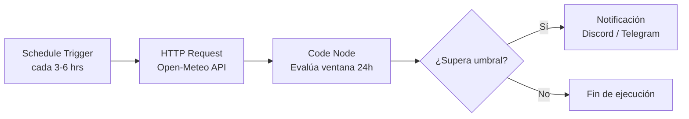
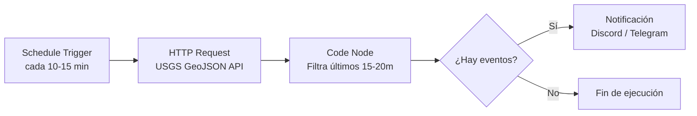

# P01 - Monitor de Alertas (Clima y Sismos) con n8n

> **Primer proyecto de aprendizaje en n8n:** Automatización simple, confiable y sin dependencias complejas, orientada a resolver casos de utilidad real para Chile (monitoreo de lluvia y sismos) utilizando n8n self-hosted en Docker.

---

## 📌 Contexto y Objetivos

Este proyecto corresponde al **P01** dentro de una progresión formativa práctica de 4 niveles para el dominio de automatización e IA aplicada:
- **P01 (Este proyecto):** Fundamentos de n8n, consumo de APIs públicas, automatización stateless programada y alertas a canales de comunicación.
- **P02:** Bot de Triage y Asistencia con IA (LLMs, agentes conversacionales y enrutamiento inteligente).
- **P03:** Automatización Multi-Servicio y Despliegue en Servidor Cloud (persistencia con base de datos, webhooks y producción 24/7).
- **P04:** Ecosistema Integrado de Automatización (orquestación avanzada, observabilidad y resiliencia).

> 💡 *Para consultar el detalle completo de los proyectos futuros y objetivos técnicos, revisa el archivo [roadmap.md](roadmap.md).*

### Metas clave de P01:
1. **Comprender el editor visual de n8n:** Triggers programados (`Schedule Trigger`), nodos HTTP (`HTTP Request`), transformaciones lógicas en JavaScript (`Code` / `Filter`) y ramificaciones (`If`).
2. **Utilidad real con cero costos:**
   - **Clima:** Uso de la API pública de **Open-Meteo** (pronóstico horario de probabilidad de lluvia sin necesidad de registrar API Keys).
   - **Sismos:** Uso de la API oficial de **USGS Earthquake** (datos en formato GeoJSON en tiempo real, sin autenticación).
3. **Diseño Stateless (sin base de datos externa):**
   - No se compara estado histórico complejo entre ejecuciones. Cada ciclo evalúa una ventana fija (ej. próximas 24h para lluvia, últimos 15–20 minutos para sismos) contra umbrales configurados.
4. **Reproducibilidad y Portafolio:** Estructura modular, documentada y lista para desplegarse localmente en Docker con un solo comando.

---

## 🎓 Progresión Pedagógica y Habilidades

Este proyecto está planteado como un escalón inicial deliberadamente acotado para asimilar la mecánica de n8n antes de incorporar agentes autónomos o bases de datos relacionales:

### Habilidades que se adquieren en este nivel:
1. **Estrategia de sondeo periódico (Polling):** Configurar `Schedule Trigger` balanceando la frescura de datos contra el consumo de red/APIs (ej. 3 horas para clima vs. 15 minutos para eventos sísmicos).
2. **Manipulación de estructuras JSON:** Navegar datos jerárquicos de respuestas REST complejas (como `FeatureCollection` de GeoJSON o arrays horarios de pronósticos) utilizando JavaScript estándar en el nodo `Code`.
3. **Estrategia de detección Stateless:** Resolver la alerta de eventos recientes mediante ventanas temporales deslizantes (últimos 20 min), eliminando la necesidad de persistir un registro histórico de "último sismo visto".
4. **Filtrado y ramificación condicional:** Emplear el nodo `If` para garantizar que las notificaciones solo se disparen cuando los datos cumplan estrictamente los umbrales fijados.
5. **Formateo de salida para mensajería:** Construir cargas útiles (payloads) con embeds visuales (títulos, colores de severidad, campos inline) compatibles con Discord Webhooks y bots de Telegram.

### Indicaciones para la exploración y práctica:
* **Simulación de alertas:** Para forzar la activación de los workflows durante pruebas, ajusta temporalmente los umbrales en el nodo `Code`:
  * En lluvia: baja `UMBRAL_PROBABILIDAD` a `0`.
  * En sismos: reduce `MIN_MAGNITUD` a `2.0` o amplía `VENTANA_MINUTOS` a `1440` (últimas 24h).
* **Inspección de datos:** Ejecuta cada nodo individualmente con el botón **Test Step** para observar cómo se transforma el objeto `$json` de un nodo a otro en la vista de tabla/JSON del editor.

---

## 🏗️ Arquitectura de los Workflows

### 1. Workflow de Alerta de Lluvia (`alerta-lluvia.json`)
* **Frecuencia:** Cada 3 a 6 horas (vía `Schedule Trigger`).
* **Fuente:** Open-Meteo Forecast API (`hourly=precipitation_probability`). Coordenadas por defecto: Viña del Mar, Chile (`lat: -33.0245, lon: -71.5518`).
* **Lógica (Code node):** Analiza el array de las próximas 24 horas y extrae si alguna supera el umbral configurado (ej. ≥ 60%).
* **Condición (If node):** Si `alerta_activa === true`.
* **Acción:** Envía mensaje con formato enriquecido a Discord (Webhook) o Telegram con el porcentaje pico y la hora estimada.



### 2. Workflow de Alerta de Sismo en Chile (`alerta-sismo.json`)
* **Frecuencia:** Cada 10 a 15 minutos (vía `Schedule Trigger`).
* **Fuente:** USGS Earthquake API (`format=geojson&minmagnitude=3.5&latitude=...`).
* **Lógica (Code node):** Filtra sismos ocurridos en la ventana de los últimos 15 a 20 minutos dentro del radio geográfico de cobertura (o caja de coordenadas de Chile), garantizando que no se dupliquen notificaciones sin necesidad de base de datos de estado.
* **Condición (If node):** Si se detectó al menos un sismo en el período (`alerta_activa === true`).
* **Acción:** Envía alerta con magnitud, profundidad, hora local y enlace al mapa del evento.



---

## 📁 Estructura del Repositorio

```text
monitor-de-alertas/
├── .env.example             # Variables de configuración y credenciales de ejemplo
├── .gitignore               # Exclusión de archivos sensibles y volúmenes locales
├── docker-compose.yml       # Definición del contenedor n8n (SQLite integrado)
├── readme.md                # Documentación del proyecto y guía pedagógica
├── roadmap.md               # Ruta general de progresión de la serie de proyectos
└── workflows/
    ├── README.md            # Guía de importación de workflows
    ├── alerta-lluvia.json   # Exportación JSON del flujo de clima
    └── alerta-sismo.json    # Exportación JSON del flujo de sismos
```

---

## 🚀 Inicio Rápido (Local con Docker)

### Requisitos previos:
- [Docker](https://docs.docker.com/engine/install/)
- `docker-compose` o `docker compose`

### 1. Clonar y configurar variables de entorno:
```bash
cp .env.example .env
```
*(Puedes ajustar la zona horaria `America/Santiago` o los umbrales si lo deseas).*

### 2. Levantar la instancia de n8n:
```bash
docker-compose up -d
```

### 3. Acceder al editor:
Abre tu navegador en:
```text
http://localhost:5678
```
Al ingresar por primera vez, n8n te solicitará configurar una cuenta de usuario local de administrador (se almacena de forma persistente en el volumen Docker `n8n_data`).

### 4. Importar los Workflows:
1. En n8n, dirígete a **Workflows** > botón de menú superior derecho (`...`).
2. Selecciona **Import from File**.
3. Carga los archivos ubicados en la carpeta `workflows/`.
4. Configura tu Webhook de Discord o Bot de Telegram en el nodo de notificación final.
5. Haz clic en **Test Step** o **Execute Workflow** para validar la ejecución manual.
