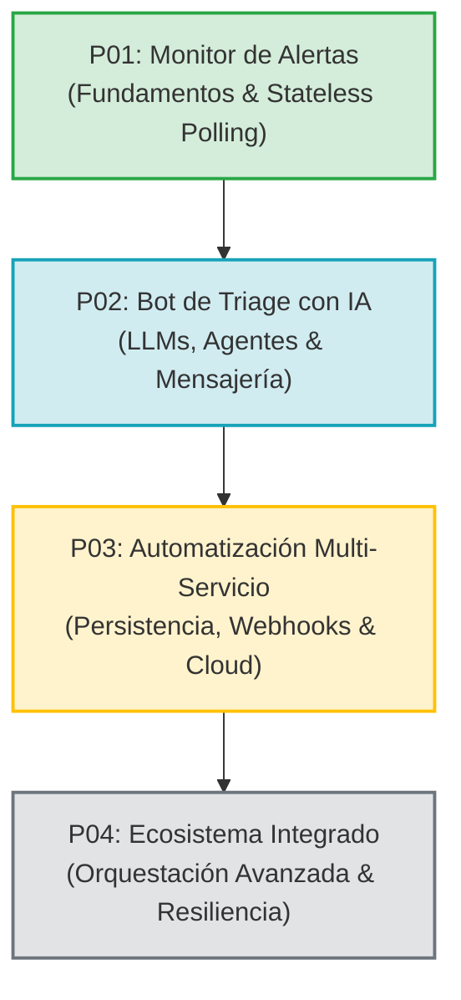

# 🗺️ Roadmap de Aprendizaje en n8n y Automatización

Este documento traza la ruta de aprendizaje progresiva a través de una serie de 4 proyectos prácticos independientes. Cada proyecto aborda un nivel superior de complejidad técnica, comenzando desde los fundamentos visuales y de datos en local hasta la integración de inteligencia artificial y la orquestación en la nube.

---

## 🧭 Visión General de la Progresión

---

## 📌 Detalle de los Proyectos

### 🟢 P01: Monitor de Alertas (Clima y Sismos)
> **Estado:** En desarrollo / Base implementada (Repositorio actual)  
> **Enfoque:** Fundamentos, polling programado y lógica condicional sin persistencia.

* **Objetivo:** Construir workflows autónomos que consultan APIs públicas en intervalos regulares, procesan datos en JavaScript y despachan notificaciones sólo si se cumplen condiciones fijas.
* **Componentes clave:**
  - `Schedule Trigger` (Intervalos y Cron).
  - Consumo de APIs REST abiertas sin credenciales complejas (Open-Meteo, USGS Earthquake).
  - Transformación y filtrado de arrays mediante nodo `Code` (JavaScript).
  - Bifurcación condicional (`If`).
  - Formateo y envío de alertas a canales de mensajería (Discord Webhooks / Telegram).
* **Concepto central adquirido:** Diseño *stateless* por ventanas temporales (detección sin necesidad de bases de datos externas de estado).

---

### 🔵 P02: Bot de Triage y Asistencia con IA
> **Estado:** Próximo  
> **Enfoque:** Nodos de Inteligencia Artificial, agentes LLM y procesamiento de lenguaje natural.

* **Objetivo:** Diseñar un asistente conversacional capaz de interactuar con usuarios en tiempo real, entender intenciones, clasificar requerimientos (triage) y enrutar solicitudes automáticamente.
* **Componentes clave:**
  - Nodos de IA / LangChain en n8n (`AI Agent`, `Chat Model`, `Prompt Memory`).
  - Integración de modelos LLM (OpenAI / Anthropic / modelos locales).
  - Triggers basados en eventos (`Discord Trigger` / `Telegram Trigger`).
  - Enrutamiento inteligente basado en la categorización de la consulta.
* **Concepto central adquirido:** Orquestación de flujos no deterministas, diseño de *prompts* y memoria conversacional.

---

### 🟡 P03: Automatización Multi-Servicio y Despliegue en Servidor Cloud
> **Estado:** Planificado  
> **Enfoque:** Arquitectura 24/7 en la nube, persistencia de datos relacionales y webhooks.

* **Objetivo:** Migrar los aprendizajes locales a una instancia de producción en un servidor cloud, incorporando base de datos persistente para trazabilidad y recepción de eventos en tiempo real.
* **Componentes clave:**
  - Despliegue self-hosted en servidor VPS / Cloud mediante contenedores.
  - Base de datos relacional dedicada (PostgreSQL).
  - Configuración de `Webhook Triggers` públicos (recepción de eventos externos).
  - Seguridad, variables de entorno protegidas y políticas de red.
* **Concepto central adquirido:** Transición de entornos de desarrollo local a infraestructuras persistentes y seguras en la nube.

---

### ⚪ P04: Ecosistema Integrado de Automatización
> **Estado:** Planificado  
> **Enfoque:** Orquestación integral, observabilidad y tolerancia a fallos.

* **Objetivo:** Conectar múltiples servicios externos y flujos paralelos en una solución unificada con manejo robusto de excepciones, reintentos automáticos y monitoreo.
* **Componentes clave:**
  - Sincronización bidireccional entre múltiples plataformas.
  - Sub-workflows modulares y reusables (`Execute Workflow`).
  - Flujos de manejo de errores globales (`Error Trigger`).
  - Telemetría y registro de auditoría de ejecuciones.
* **Concepto central adquirido:** Resiliencia, modularidad avanzada y arquitectura empresarial de automatizaciones.

---

## 🎯 Principios de Diseño en toda la Serie

1. **Autocontenido y Reproducible:** Cada repositorio contiene todo lo necesario para levantarse en Docker sin dependencias ocultas.
2. **Utilidad Real:** Cada caso de uso resuelve un problema práctico comprensible.
3. **Calidad de Portafolio:** Código limpio, estructurado y documentado bajo estándares de la industria.
